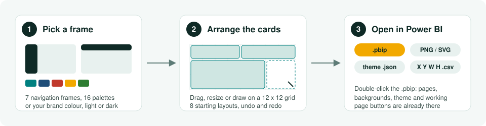
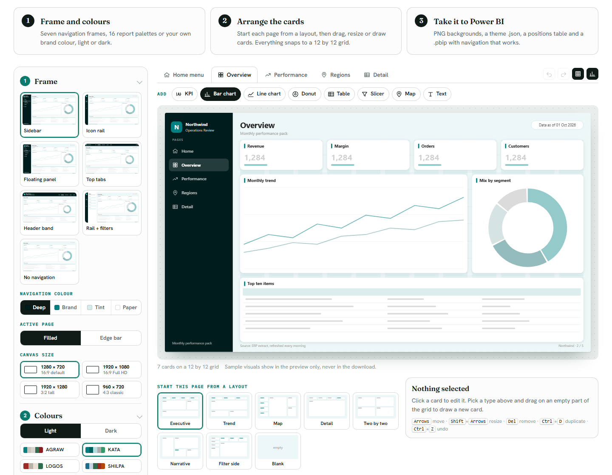
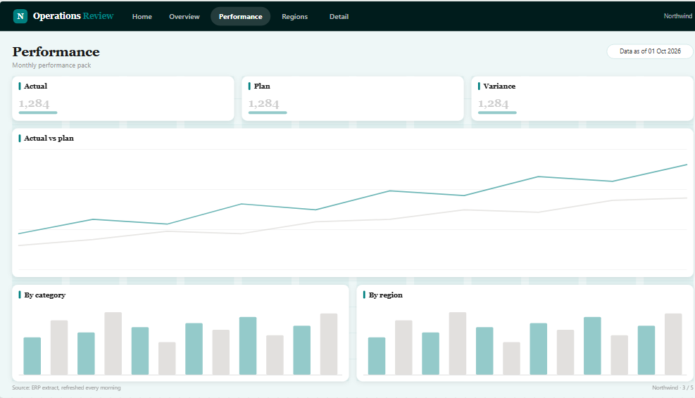
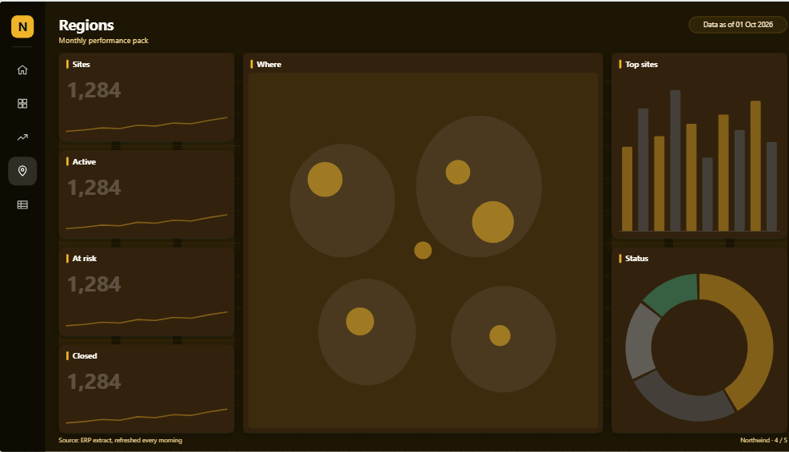
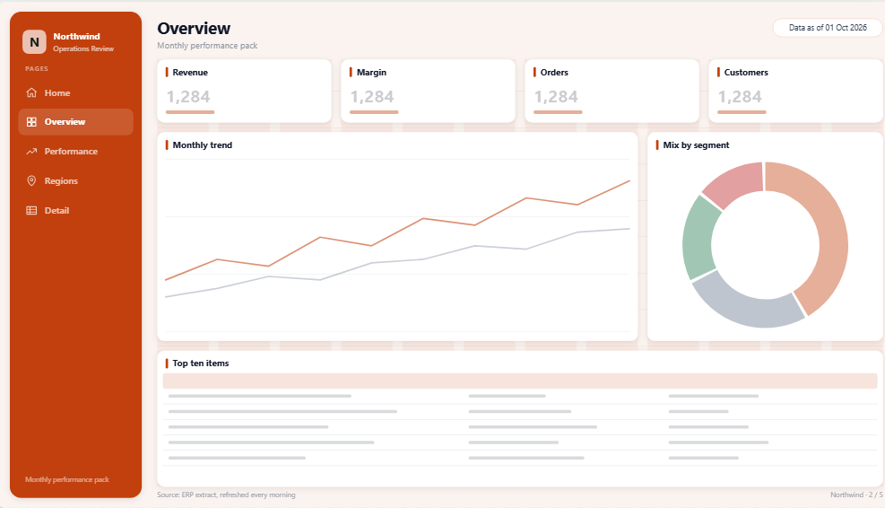
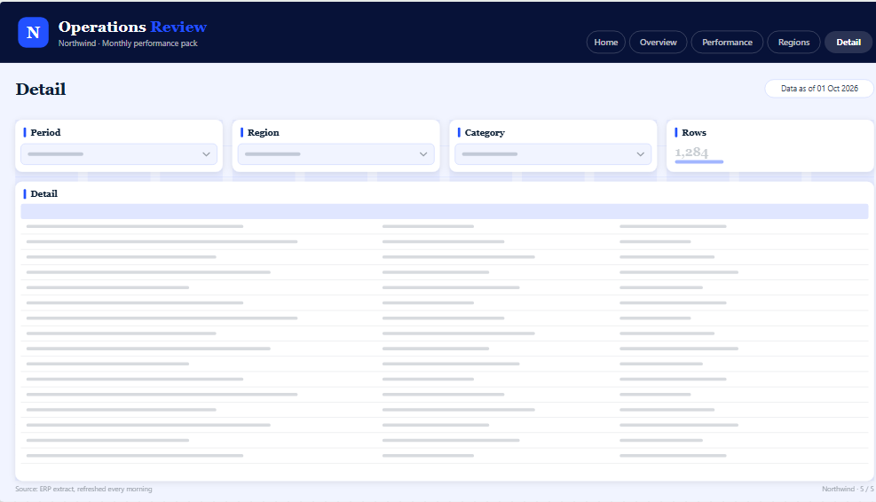
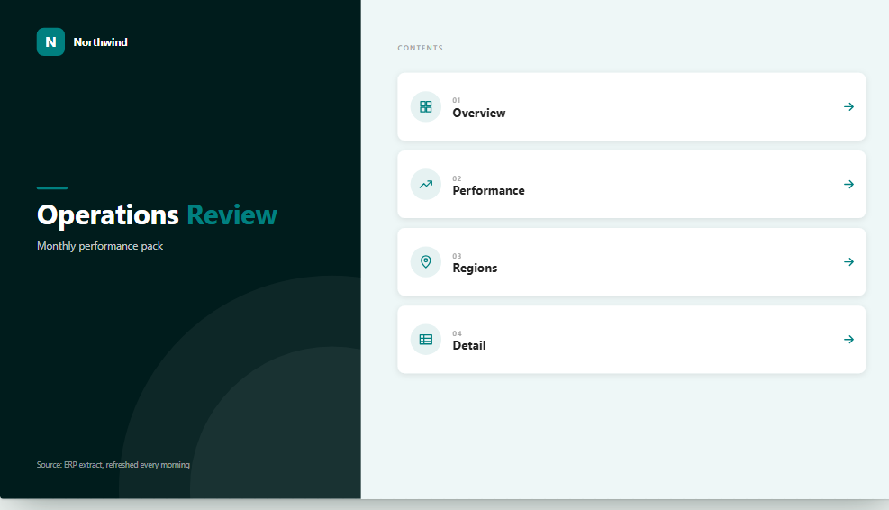
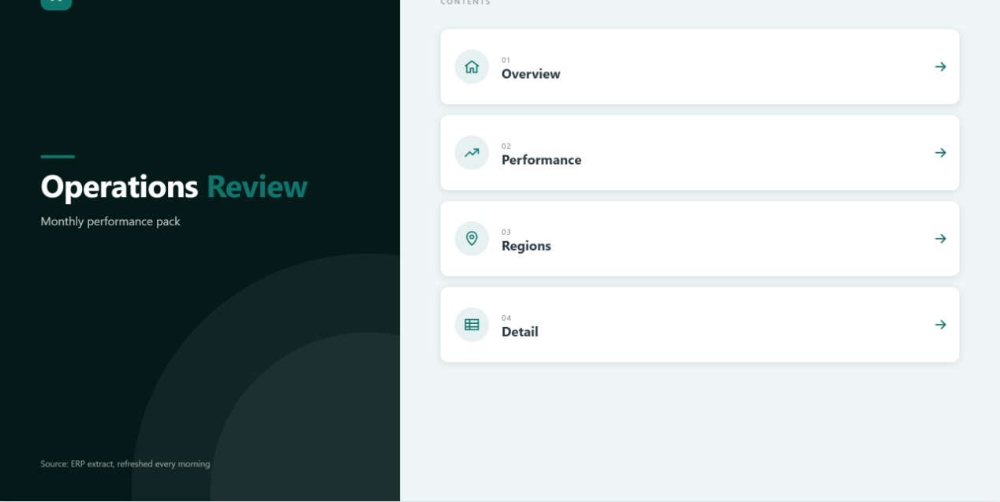
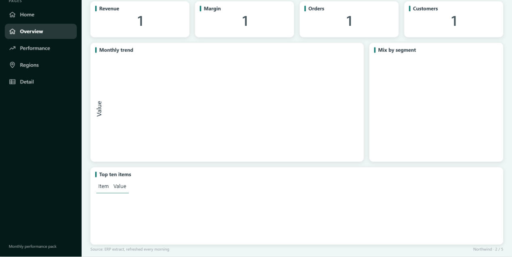

# Power BI Layout Studio

**Design a Power BI report page in your browser, then open it in Power BI Desktop with the navigation already working.**

[](https://babarda.com/tools/powerbi-layout/)
[](https://babarda.github.io/powerbi-layout-studio/app/)




---

## 1. What you see



Left: the settings. Middle: a live canvas of your page. Bottom: starting layouts. Click any card to move or resize it.

## 2. Seven frames, 16 palettes, light or dark

| Top tabs, AGRAW | Icon rail, SENTINEL, dark |
|---|---|
|  |  |
| **Floating panel, OBEYA** | **Header band, EVIDENTIA** |
|  |  |

Every report also gets a **home menu page**, one tile per page:



## 3. What you download

| File | What it is | Where it goes in Power BI Desktop |
|---|---|---|
| **`.pbip` project (zip)** | Every page with its background, the theme, a placeholder visual on each card and page buttons that navigate | Unzip to a short path such as `C:\PBI\`, double-click the `.pbip` |
| **PNG** (2x) or **SVG** | The page background: frame, navigation, card shapes | Format page > Canvas background > Image, fit **Fit** |
| **Theme `.json`** | Data colours, fonts, transparent visuals so the background shows through | View > Themes > Browse for themes |
| **Positions `.csv`** | X, Y, width and height of every card | Type them in Format > General > Properties |
| **Zip of every page** | All of the above in one file, with a short read-me | |

## 4. Proof: the `.pbip` opened in Power BI Desktop

| Home menu | Overview page |
|---|---|
|  |  |

Tested on Power BI Desktop 2.158 (October 2026). The project passes `powerbi-report-author validate` with 0 errors and 0 warnings. Each placeholder binds to a one-row `Placeholder` table, so you swap it for your own visual and keep its position.

## 5. Use it

| You want to | Do this |
|---|---|
| Just use it | Open [babarda.com/tools/powerbi-layout](https://babarda.com/tools/powerbi-layout/). Nothing to install, nothing uploaded. |
| Run it on your PC | Download this repo, then `npx serve app` and open the address it prints. (Opening `app/index.html` by double-click does not work: browsers block modules on `file://`.) |
| Change the code | Edit `site/powerbi-layout.astro`, the page as it runs on babarda.com (Astro). |

Your work saves in your browser (local storage), so the page comes back as you left it.

## 6. Keyboard

| Keys | Action |
|---|---|
| Arrows | move the selected card |
| Shift + arrows | resize it |
| Del | remove it |
| Ctrl + D | duplicate |
| Ctrl + Z / Ctrl + Y | undo / redo |

## Repository

```
app/index.html        the full app, one page, CSS inlined
app/themekit.js       colour engine (from theme-kit)
app/CY26SU02.json     base Power BI theme the export extends
site/                 the Astro source on babarda.com
docs/                 the images in this page
```

## Related

- [theme-kit](https://github.com/babarda/theme-kit): one brand in, themes for Power BI, PowerPoint, Excel, Word, Python and CSS out, plus a colour-blind check
- [powerbi-project-templates](https://github.com/babarda/powerbi-project-templates): S-curve, milestones, RACI, 3-week look-ahead

## Licence

MIT. By [Badr Abardazzou](https://babarda.com).
